<p align="center">
  
</p>

# first principles

An agent skill that makes Claude Code, Codex and other agents reason from first principles instead of by analogy. It works for engineering, product and strategy questions.

When a request rests on "that's how it's done", "it can't be done" or "it has always cost this much", the agent breaks the problem down to what is verifiably true, prices the floor, and rebuilds options from the facts alone. Each step has a done-when check, so the agent can't jump straight to an answer.

## What first-principles thinking is

Most of the time we copy. We do what worked last time, or what everyone else does. That's fast and usually fine. It goes wrong when the thing we're copying was never true, or stopped being true.

Thinking from first principles means asking what you actually know is true, setting aside what you've only assumed, and building your answer from the true part. You don't have to dig to the bottom of the universe. Going one or two levels deeper than everyone else is usually enough.

Farnam Street explains it with a Lego house. Look at the house and you'll move a few bricks around. Take it apart and you can build a better house, or something else entirely. Elon Musk's batteries are the version with numbers. Everyone said battery packs cost $600 per kWh and always would. The materials inside cost about $80.

It takes more effort than copying, so save it for problems where the usual answer is expensive, you're stuck, or things have changed.

## What makes this skill different

If you just tell a model to "think from first principles", it decides what that means, and you can end up with the usual answer in new words. This skill gives the agent fixed steps instead, and you can check each one.

- Every step has a clear finish line, so the agent can't skip ahead.
- Every claim is labelled as a fact or an assumption. A fact needs a source. "That's how it's done" counts as an assumption.
- The agent has to put a number on the best possible outcome, like what the raw materials cost. The gap between that and today is the opportunity.
- At least one idea has to be genuinely different from what you do now, not a tweak.
- Each idea comes with what would prove it wrong and the cheapest way to test that.
- It notices phrases like "industry standard" or "it's never been done" and questions them.
- It stays small. The engineering, product and strategy guides load only when needed.
- You get the same short note every time: the goal, the facts and assumptions, the best possible number, the options, and a recommendation.

## What the agent does

1. **States the goal as an outcome**, without naming the current solution.
2. **Lists the accepted answer and every claim under it**, including the obvious ones.
3. **Breaks the system into its parts**, one or two levels below the existing solution.
4. **Sorts each claim into fact or assumption** using Socratic questioning and the Five Whys. Facts need a source.
5. **Prices the floor**: the best the physics, data or economics allows. (Battery cells were "$600/kWh". Their raw materials cost about $80.)
6. **Rebuilds options from the facts**, including at least one that departs from the accepted approach.
7. **Tries to falsify each option**, and names the assumption that would kill it and the cheapest test to run first.

The output is a short working note with the goal, a table of claims, the floor, options and a recommendation. [`APPLICATIONS.md`](skills/first-principles/APPLICATIONS.md) has separate playbooks for engineering, product and strategy, and the agent loads only the one it needs.

## Install

**Any agent with the [skills CLI](https://skills.sh)**

```bash
npx skills add v60samurai/first-principles
```

**Claude Code, by hand**

```bash
git clone https://github.com/v60samurai/first-principles ~/src/first-principles
ln -s ~/src/first-principles/skills/first-principles ~/.claude/skills/first-principles
```

**Codex**: link the same folder into `~/.agents/skills/first-principles`.

The skill triggers on its own description. You can also run it directly with `/first-principles <problem>`.

### Optional: trigger it from your prompts

[`hooks/first-principles-trigger.sh`](hooks/first-principles-trigger.sh) is a `UserPromptSubmit` hook that uses `jq`. It stays silent unless the prompt matches one of two kinds of phrase:

- **"first principles"** tells the agent to run the skill.
- **Phrases that lean on convention**, such as "industry standard", "can't be done", "why do we", "build vs buy", "challenge my assumptions" and "move first", add a short note that quotes the phrase. The agent decides whether it applies, and ignores it for lookups and bug fixes.

It matches phrases, with no model call, so it adds no latency. To register it, add this to `~/.claude/settings.json`:

```json
{
  "hooks": {
    "UserPromptSubmit": [
      { "hooks": [{ "type": "command", "command": "sh ~/src/first-principles/hooks/first-principles-trigger.sh", "timeout": 5 }] }
    ]
  }
}
```

## Layout

```
skills/first-principles/SKILL.md          the steps, questioning tools, signals of analogy, output format
skills/first-principles/APPLICATIONS.md   engineering, product and strategy playbooks, worked examples
hooks/first-principles-trigger.sh         optional prompt hook
assets/banner.py                          generates assets/banner.svg
```

The banner is a hand-written SVG with CSS animation. A brick house breaks into its parts and rebuilds as a rocket, which is the article's own Lego example. Run `python3 assets/banner.py` to regenerate it. It holds still when the viewer has reduced motion turned on.

## Credit

The method and examples come from Farnam Street's article [First Principles: The Building Blocks of True Knowledge](https://fs.blog/first-principles/), with Socratic questioning, the Five Whys, and the SpaceX, battery, BuzzFeed and CD Baby cases. This project isn't affiliated with Farnam Street. The engineering and product playbooks extend the article and aren't from it.

## License

[MIT](LICENSE)
